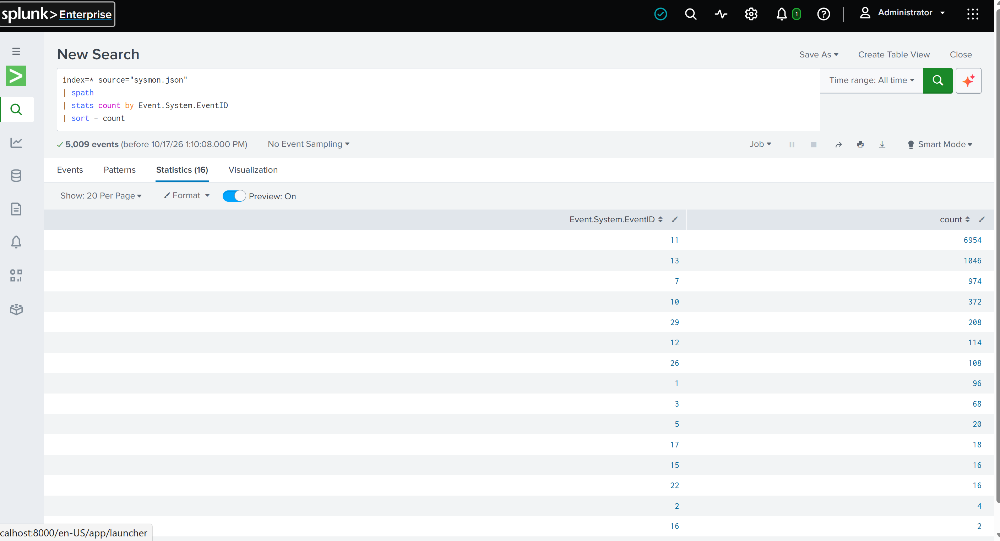
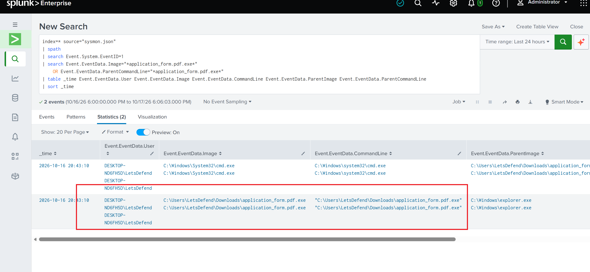
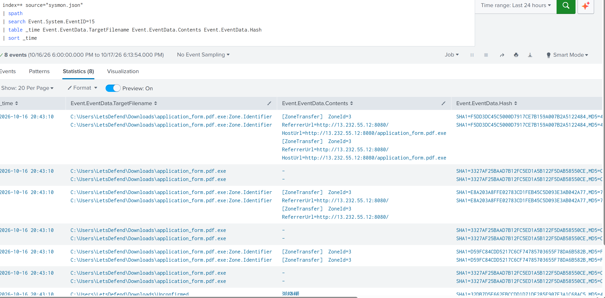
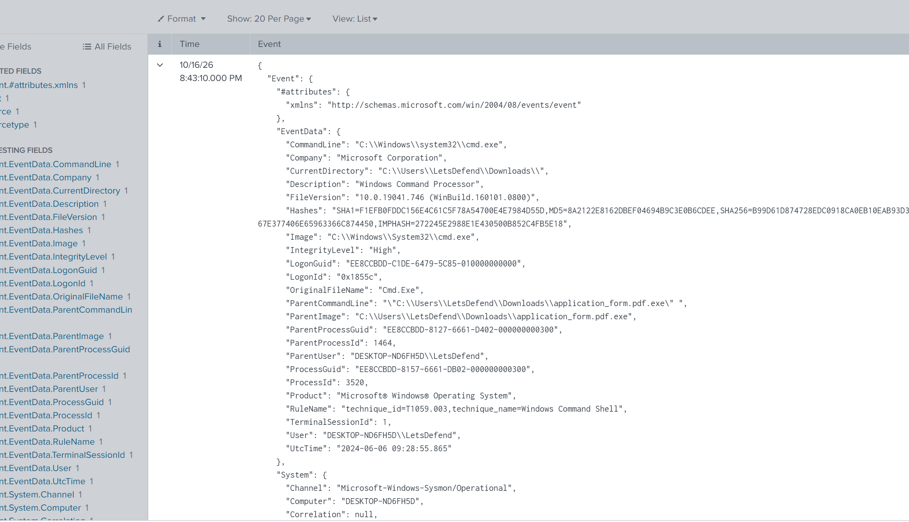
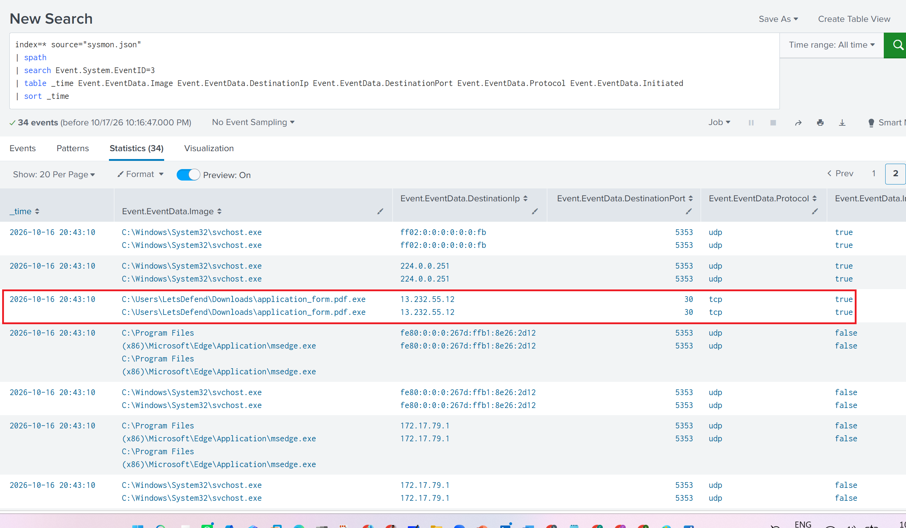
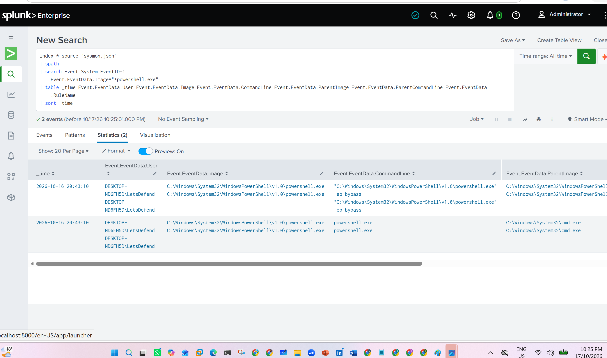
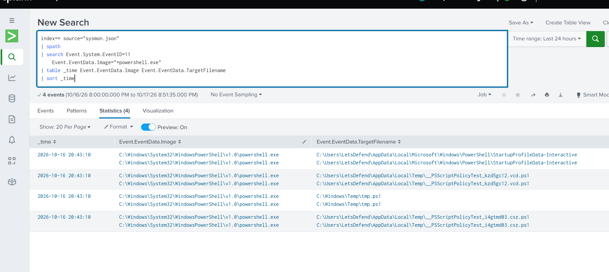
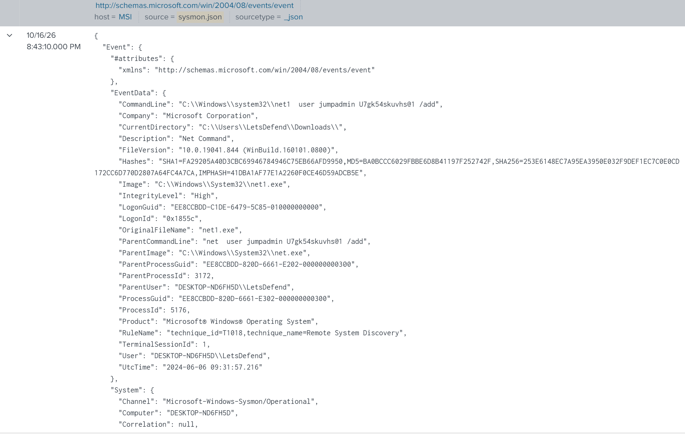
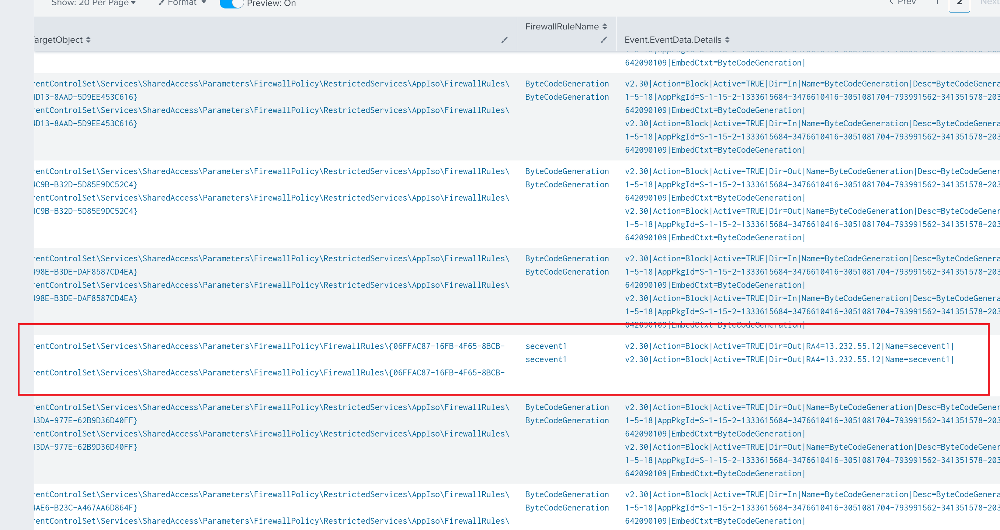

# Windows Sysmon Threat Hunting with Splunk

## 1. Project Overview

This project documents a Windows threat hunting investigation conducted in Splunk Enterprise using Sysmon telemetry. The dataset and investigation scenario were provided by **LetsDefend**.

The investigation focused on a suspicious executable and related Windows activity, including process creation, network connections, PowerShell activity, account related commands, registry modifications, and file-origin metadata.

Splunk Search Processing Language (SPL) was used to search the JSON formatted events, extract nested fields, and organize the available evidence.

The goal was to document the observed activity, explain why it warranted investigation, and distinguish confirmed telemetry from conclusions requiring additional evidence.

## 2. Lab Environment

- **SIEM:** Splunk Enterprise
- **Dataset:** `sysmon.json`
- **Data format:** JSON
- **Sourcetype:** `_json`
- **Host identified in the dataset:** `MSI`
- **Dataset and scenario source:** LetsDefend

The searches use `spath` to extract fields from nested JSON events.

## 3. Investigation Methodology

The investigation followed these steps:

1. Review the distribution of Sysmon event IDs.
2. Search for suspicious terms and rule identifiers.
3. Identify and investigate `application_form.pdf.exe`.
4. Examine process creation and parent-child relationships.
5. Review file origin metadata.
6. Investigate network connection events.
7. Examine PowerShell process and file-creation activity.
8. Investigate account related command execution.
9. Review firewall related registry activity.
10. Summarize findings and defensive recommendations.

The investigation treats suspicious events as leads for further analysis rather than automatically treating them as proof of a successful attack.

## 4. Phase One - Sysmon Event Distribution

I began by reviewing the distribution of Sysmon event IDs to understand which types of activity were present in the dataset.

```spl
index=* source="sysmon.json"
| spath
| stats count by Event.System.EventID
| sort - count
```

This query groups events by Sysmon event ID and sorts them by frequency. It provides an overview of the available telemetry before focusing on specific behaviors.

**Evidence - Figure 1: Sysmon event distribution.**



## 5. Phase Two - Initial Search for Suspicious Activity

I used the following exploratory search to look for events containing the MITRE ATT&CK technique identifier `T1036` or the phrase `remote access`.

```spl
index=* source="sysmon.json"
| spath
| search "T1036" OR "remote access"
| table _time Event.EventData.Image Event.EventData.OriginalFileName Event.EventData.CommandLine Event.EventData.RuleName
```

`T1036` refers to **Masquerading** in MITRE ATT&CK. The phrase `remote access` is a separate search term and is not synonymous with T1036.

During the investigation, I identified the following executable as suspicious:

`C:\Users\LetsDefend\Downloads\application_form.pdf.exe`

The filename resembles a PDF document but ends with `.exe`. This may be an attempt to mislead a user about the file type, so the executable warranted further investigation. The filename alone does not prove that it is malicious.

This initial search should only be credited with identifying the executable if the actual search results show the relevant filename. If it was identified during a later process investigation, the README should describe this as an exploratory search followed by a separate discovery step.

**Evidence - Figure 2: Initial `T1036` / `remote access` search.**


## 6. Phase Three - Suspicious Executable Process Investigation

I examined Sysmon Event ID 1 records to investigate process creation involving the suspicious executable.

```spl
index=* source="sysmon.json"
| spath
| search Event.System.EventID=1
    Event.EventData.Image="*application_form.pdf.exe"
| table _time Event.EventData.User Event.EventData.Image Event.EventData.CommandLine Event.EventData.ParentImage Event.EventData.ParentCommandLine Event.EventData.RuleName
| sort _time
```

Sysmon Event ID 1 records process creation. This query focuses on events where the process image matches the suspicious executable and displays the associated user, command line, and parent-process information.

These fields help establish the process context and identify relationships that may warrant additional investigation.

**Evidence - Figure 3: Process creation involving the suspicious executable.**



## 7. Phase Four - Download-Origin Metadata Investigation

I searched Sysmon Event ID 15 records for file stream information that could help establish a file's origin.

```spl
index=* source="sysmon.json"
| spath
| search Event.System.EventID=15
| table _time Event.EventData.TargetFilename Event.EventData.Contents Event.EventData.Hash
| sort _time
```

Sysmon Event ID 15 can record named-stream activity, including `Zone.Identifier` metadata associated with files obtained from external sources. Where available, this metadata may contain a `HostUrl` or `ReferrerUrl`.

The results must be checked for those fields before reporting a download source. A suspicious filename or file-creation event alone does not establish where a file originated.

**Evidence - Figure 4: Event ID 15 file-origin metadata search.**



## 8. Phase Five - Command-Shell Execution Investigation

The investigation identified a Sysmon Event ID 1 record for `cmd.exe` with these details:

- **Process image:** `C:\Windows\System32\cmd.exe`
- **Parent image:** `C:\Users\LetsDefend\Downloads\application_form.pdf.exe`
- **Parent command line:** `"C:\Users\LetsDefend\Downloads\application_form.pdf.exe"`
- **Event time in UTC:** `2024-06-06 09:28:55.865`
- **Associated rule:** `T1059.003 - Windows Command Shell`

The parent-process information records the suspicious executable as the parent of `cmd.exe`. This supports the finding that command-shell execution was associated with the executable.

Sysmon Event ID 1 records process creation; it does not record every command typed into an already-running command prompt. Additional telemetry would be required to establish which commands were executed inside the shell.

```spl
index=* source="sysmon.json"
| spath
| search Event.System.EventID=1
    Event.EventData.Image="*cmd.exe"
    Event.EventData.ParentImage="*application_form.pdf.exe"
```

**Evidence - Figure 5: `cmd.exe` process creation and parent-process relationship.**



## 9. Phase Six - Network Connection Investigation

I reviewed Sysmon Event ID 3 records to examine network connections captured in the dataset.

```spl
index=* source="sysmon.json"
| spath
| search Event.System.EventID=3
| table _time Event.EventData.Image Event.EventData.DestinationIp Event.EventData.DestinationPort Event.EventData.Protocol Event.EventData.Initiated
| sort _time
```

Sysmon Event ID 3 records network connection activity when the relevant logging is enabled. The process image, destination IP address, destination port, protocol, and connection direction can help an analyst investigate network behavior.

Network events should be correlated with process activity and timestamps before being attributed to the suspicious executable. A network connection alone does not establish command-and-control activity or malicious intent.

**Evidence - Figure 6: Network connection investigation.**



## 10. Phase Seven - PowerShell Process Investigation

I searched Sysmon Event ID 1 records for PowerShell processes and reviewed the available command-line and parent-process information.

```spl
index=* source="sysmon.json"
| spath
| search Event.System.EventID=1
    Event.EventData.Image="*powershell.exe"
| table _time Event.EventData.User Event.EventData.Image Event.EventData.CommandLine Event.EventData.ParentImage Event.EventData.ParentCommandLine Event.EventData.RuleName
| sort _time
```

This query displays PowerShell firewall related events. The command line and parent-process information can help determine whether a particular invocation requires further investigation.

PowerShell is a legitimate Windows administration tool. Its presence alone does not indicate malicious activity; its significance depends on the commands, process relationships, timing, and surrounding evidence.

**Evidence - Figure 7: PowerShell firewall related investigation.**



### 10.1 PowerShell-Related File Creation

I also searched Sysmon Event ID 11 records for file creation associated with a PowerShell process.

```spl
index=* source="sysmon.json"
| spath
| search Event.System.EventID=11
    Event.EventData.Image="*powershell.exe"
| table _time Event.EventData.Image Event.EventData.TargetFilename
| sort _time
```

Sysmon Event ID 11 records file creation. The process image and target filename provide context about the file operation and can help identify activity requiring further review.

File creation alone does not prove that a file was downloaded, successfully executed, or malicious.

**Evidence - Figure 8: PowerShell-related file-creation investigation.**



## 11. Phase Eight - Account-Related Command Investigation

I searched Sysmon firewall related records for `net.exe` to investigate account-related command activity.

```spl
index=* source="sysmon.json"
| spath
| search Event.System.EventID=1 AND "net.exe"
| sort _time
```

The results included a `net1.exe` process with a command line consistent with an attempt to add a local user account.

The relevant event contained these details:

- **Event time in UTC:** `2024-06-06 09:31:57.216`
- **Process image:** `C:\Windows\System32\net1.exe`
- **Original filename:** `net1.exe`
- **Parent image:** `C:\Windows\System32\net.exe`
- **Parent command line:** `net user jumpadmin [REDACTED] /add`
- **Process command line:** `C:\Windows\system32\net1 user jumpadmin [REDACTED] /add`
- **User context:** `DESKTOP-ND6FH5D\LetsDefend`
- **Integrity level:** High
- **Associated rule:** `T1018 - Remote System Discovery`

The `/add` argument is consistent with an attempt to create an account named `jumpadmin`. The firewall related event shows that the command was launched, but it does not independently confirm that the account was successfully created.

The associated rule name is a detection label in the telemetry. The command line should be interpreted on its own merits rather than assuming it proves remote system discovery.

**Evidence - Figure 9: Account-related command investigation.**



**Credential hygiene:** Redact passwords or other sensitive values from screenshots before committing them to GitHub.

## 12. Phase Nine - firewall related Registry Investigation

I reviewed Sysmon Event ID 13 records to identify registry value modifications that might be relevant to firewall configuration.

```spl
index=* source="sysmon.json"
| spath
| search Event.System.EventID=13
| table _time Event.EventData.Image Event.EventData.TargetObject Event.EventData.Details Event.EventData.RuleName
| sort _time
```

Sysmon Event ID 13 records registry value modifications. The target object and details can help identify the registry location and value involved.

The investigation included a registry event referencing `Microsoft Edge (mDNS-In)`. The name is associated with a firewall related entry, but the registry event alone does not establish that the suspicious executable created it or that a firewall rule was successfully enforced.

The event should be assessed using its process image, timestamp, registry path, value details, and any corroborating telemetry.

**Evidence - Figure 10: firewall related registry investigation.**



## 13. Investigation Summary

| Investigation area | Observation | Evidence-supported interpretation |
|---|---|---|
| Initial search | Search terms included `T1036` and `remote access` | Exploratory filtering to narrow the investigation |
| Suspicious executable | `application_form.pdf.exe` was identified in the Downloads directory | Filename and extension warranted further investigation |
| Process creation | The executable was recorded as the parent of `cmd.exe` | Evidence of command-shell execution associated with the executable |
| File-origin metadata | Sysmon Event ID 15 was searched | Origin information can only be reported if relevant metadata is present |
| Network activity | Sysmon Event ID 3 records were reviewed | Connections can be investigated and correlated with processes |
| PowerShell process activity | PowerShell Event ID 1 records were reviewed | Process and command-line context is available for analysis |
| PowerShell file creation | PowerShell-associated Event ID 11 records were reviewed | Recorded file-creation activity can be examined |
| Account-related command | `net1.exe` ran with arguments consistent with adding `jumpadmin` | Evidence of an account-creation attempt, not confirmation of success |
| Registry activity | A registry event referenced `Microsoft Edge (mDNS-In)` | firewall related configuration requires further validation |

These observations do not establish that all events were causally related to one another.

## 14. Findings Summary

The investigation identified the following observations:

1. **Suspicious executable:** `C:\Users\LetsDefend\Downloads\application_form.pdf.exe` was identified for further investigation because its filename resembles a document while retaining an executable extension.
2. **Command-shell execution:** A firewall related event recorded the executable as the parent of `cmd.exe`.
3. **Account-related command:** A `net1.exe` process was launched with arguments consistent with an attempt to add `jumpadmin`.
4. **PowerShell activity:** PowerShell firewall related and file-creation events were examined.
5. **Network activity:** Sysmon network connection events were reviewed for context and correlation.
6. **Registry activity:** A registry event referenced `Microsoft Edge (mDNS-In)`, but its origin and operational effect require additional validation.
7. **File-origin metadata:** Event ID 15 was searched for metadata that could help establish file origin.

These findings provide investigative leads and document observed process relationships. They do not independently establish a complete attack sequence, successful account creation, malicious network communications, or enforcement of a firewall change.

## 15. Defensive Recommendations

- **Monitor executable launches from user-writable locations.** Investigate unusual executable activity in Downloads and temporary directories.
- **Investigate masquerading behavior.** Review filenames that use document-like names or multiple extensions.
- **Monitor account-management commands.** Investigate unusual use of `net.exe` and `net1.exe`, especially commands attempting to add accounts.
- **Correlate process trees.** Review parent child relationships when unfamiliar executables launch command shells or administrative utilities.
- **Review PowerShell activity.** Collect command-line and script-block telemetry where appropriate and investigate unusual process relationships.
- **Correlate network events.** Review process identity, destination details, timing, and surrounding telemetry before classifying a connection as malicious.
- **Audit firewall changes.** Validate registry modifications against firewall configuration and relevant operational logs.
- **Preserve file-origin evidence.** Retain useful metadata to support investigations into suspicious files.

## 16. Investigation Limitations

This investigation is based on the Sysmon telemetry available in the LetsDefend dataset.

- The initial search is exploratory and does not establish that every matching event is malicious.
- Sysmon Event ID 1 records process creation, not every command entered into an existing shell.
- Sysmon Event ID 11 records file creation and does not prove that a file was downloaded.
- Sysmon Event ID 13 records a registry value modification and does not independently prove that a firewall rule was enforced.
- A command line attempting to create an account does not confirm that the operation succeeded.
- Network connection events alone do not establish command-and-control activity.
- A download URL or causal relationship between events should not be asserted without supporting evidence.
- Screenshot captions must match the actual images and query results before publication.


## 19. Skills Demonstrated

This project demonstrates practical experience with:

- Splunk Enterprise and SPL
- Searching and filtering Sysmon telemetry
- Extracting nested JSON fields with `spath`
- Investigating process creation and parent-child relationships
- Reviewing network connection events
- Examining PowerShell process and file-creation activity
- Investigating account-related commands
- Reviewing registry value modifications
- Summarizing evidence and investigation limitations
- Writing defensive recommendations based on observed behavior

## 19. Conclusion

This project demonstrates how Sysmon telemetry in Splunk can support an investigation into a suspicious Windows executable and related system activity.

The investigation began with an exploratory search and identified `application_form.pdf.exe` as an executable requiring further examination. firewall related telemetry showed a relationship between the executable and `cmd.exe`. Additional searches examined network connections, PowerShell activity, account-related commands, registry modifications, and file origin metadata.

The investigation reinforces a central principle of threat hunting: suspicious indicators must be validated through evidence and correlation. Accurate documentation should distinguish observed events from assumptions and clearly state what the available telemetry can and cannot prove.

**Dataset and scenario credit:** LetsDefend.
